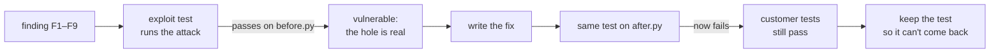

# AI-built app teardown

[](https://github.com/joshuavivo/ai-built-app-teardown/actions/workflows/tests.yml)
[](LICENSE)

**An app can pass every demo and still hand a stranger your payment account, your customer list or
a free checkout.** This is what an audit of one looks like: each hole found, proven with a test that
runs the attack, fixed, and kept fixed.

A small booking app for a fictional dog groomer, built the way a fast first version often comes
out of an AI coding tool, then audited and fixed. It is a JSON API with no UI. Every endpoint
works. The nine holes are in the parts a normal customer never touches.

I built this to show how I audit an app that went live quickly: find the easy ways in, prove each
one with a test that runs the attack, fix it, and keep the test so it stays fixed.

**Start with [REPORT.md](REPORT.md).** It's the plain-English write-up a business owner would get.

## The nine findings

| # | Finding | Who could do it | What they'd get | Severity |
|---|---|---|---|---|
| F1 | Payment **secret** key shipped to every browser | Any visitor | Control of the payment account | **Critical** |
| F2 | Login cookie is just the user's id number | Any visitor | Log in as anyone, including the owner | **Critical** |
| F3 | Change the id in the URL, read another booking | Any customer | Others' gate codes and notes | High |
| F4 | Search box concatenated into the SQL | Any customer | Every booking in the system | High |
| F5 | Checkout charges whatever the browser sends | Any customer | An $85 groom for 1¢ | High |
| F6 | Customer-list export with no auth check | Any visitor | Every customer's name, email, phone | High |
| F7 | Unlimited password guesses | Any visitor | Into any weak-password account | Medium |
| F8 | Passwords stored as unsalted MD5 | Anyone with the DB | Most passwords, in minutes | Medium |
| F9 | Errors return the full stack trace | Any visitor (no login needed) | A map of the code | Low |

Each one has a check in `exploits.py` that runs the attack: it succeeds on `before.py` and fails on `after.py`, and a second set of tests proves the fixed app still works for real customers.



## Three of them, in code

**F2 — the session cookie was the user id.** Change `uid=2` to `uid=1` in your browser and you're the owner.

```python
# before.py
uid = req.cookies.get("uid")                      # the cookie *is* the user id
# after.py
uid, issued = sessions.get(req.cookies.get("session", ""), (None, 0.0))  # random server-side token
if time.monotonic() - issued > SESSION_SECONDS: ...  # and it expires after 12 hours
# ...the cookie is set HttpOnly; Secure; SameSite=Lax, and logout deletes the token on the server
```

**F4 — the search box was pasted straight into the query.** Typing `' or 1=1 --` returns every booking.

```python
# before.py — q goes into the SQL text
sql = f"select ... where user_id = {user['id']} and dog like '%{q}%'"
db.execute(sql)
# after.py — q is a bound value, never part of the query ('%' and '_' escaped too)
db.execute("select ... where user_id = ? and dog like ? escape '\\'", (user["id"], f"%{q}%"))
```

**F5 — the browser told the server what to charge.** Edit the request and an $85 groom costs 1¢.

```python
# before.py — trust the amount in the request
amount = int(body["amount"])
# after.py — the browser picks the service; the server owns the price
if service not in seed.SERVICES:
    return reply(sr, 400, {"error": "Unknown service"})
amount = seed.SERVICES[service]
```

The other six — the shipped payment secret, the IDOR on bookings, the unprotected export, unlimited login attempts, MD5 passwords, and the stack-trace leak — are in [REPORT.md](REPORT.md), each with its own before/after and test.

## What's here

| File | What it is |
|---|---|
| `before.py` | The app as first written. Each flaw is tagged `F1`–`F9` |
| `after.py` | The same app, same routes, same data, with each fix tagged |
| `exploits.py` | One attack per finding. Returns `True` if the attack worked |
| `tests/` | Each attack must work on `before` and fail on `after`, and the fixed app must still work for customers |
| `seed.py` | The made-up customers and bookings |
| `web.py` | A few lines of request plumbing and an in-process test client |

## Run it

```bash
python3 -W error::ResourceWarning -m unittest discover -s tests    # the proof (what CI runs)
python3 before.py                        # http://127.0.0.1:8000, local only
python3 after.py                         # http://127.0.0.1:8001
```

With `after.py` running, log in as one of the made-up customers and ask who you are:

```bash
curl -i -c cookies.txt -X POST http://127.0.0.1:8001/api/login \
  -H 'Content-Type: application/json' \
  -d '{"email": "alex@example.com", "password": "alex-pass-123"}'
# HTTP/1.0 200 OK
# Set-Cookie: session=<random token>; Path=/; HttpOnly; Secure; SameSite=Lax
# {"ok": true}

curl -b cookies.txt http://127.0.0.1:8001/api/me
# {"email": "alex@example.com", "name": "Alex Moreno"}
```

## Limits

- Nine fixed findings do not make this app secure. The nine flaws in `before.py` are deliberate
  (each is tagged there with its finding number), so this repo shows the method on an app
  whose flaws were known in advance. It is not evidence of finding flaws in code I did not
  write. The items below are gaps I know remain.
- The fixes are the standard ones, kept small enough to read. Some would be done differently in
  production: sessions and lockout counters would live in a database or cache rather than memory,
  and the lockout would also count by network address so one person can't lock out many accounts.
- Locking an account after 5 failures also lets a stranger lock out a real customer on purpose.
  A real app weighs that against a delay that grows with each failure, or a CAPTCHA.
- The login answers slightly faster for an email that doesn't exist, which can hint at who has an
  account. Not fixed here.
- The customer-list export writes names straight into CSV. A name starting with `=`, `+`, `-` or
  `@` can run as a formula when the owner opens the file in a spreadsheet, and a comma in a name
  shifts the columns. A real export quotes every field and neutralises those first characters.
- The failed-login counter keeps an entry for every email anyone tries, and an expired session is
  only removed when someone presents it again, so both grow without limit. A real app keeps them
  in a cache with expiry.
- Logout ends the session it's called from. Other sessions for the same person stay live until
  they expire; a real app offers "log out everywhere" and ends all sessions on a password change.
- There's no request-size limit: a large body is read whole before anything checks it. A real
  deployment caps it at the proxy or in the app.
- There's no CSRF token. `SameSite=Lax` covers the cross-site form case for these routes, but a
  real app with state-changing GET requests or older browsers needs one.

Standard library only, Python 3.11 or later. The tests run in-process; the demo servers listen on 127.0.0.1 only.

## Credits

Architected and directed by [Joshua Vivo](https://github.com/joshuavivo) ([Shadow Vivo LLC](https://shadowvivo.com)), built with AI assistance (Claude). The design and the judgment are mine.
